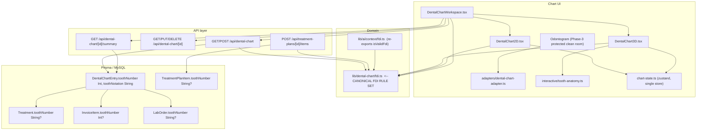
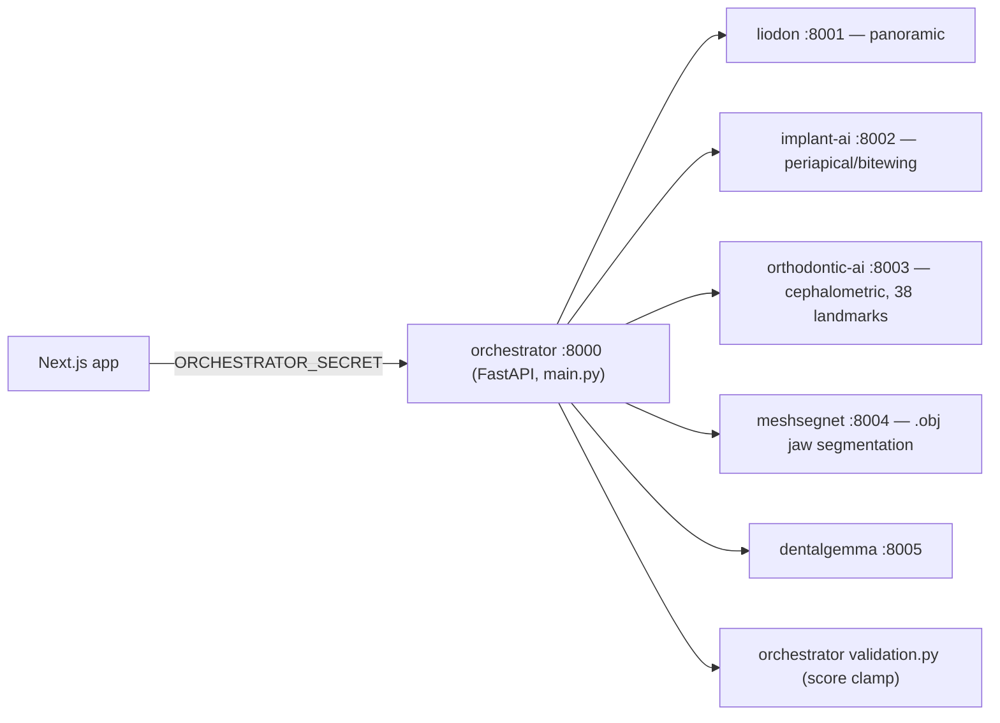

# ARCHITECTURE.md

## Chart data flow

## AI runtime

## Tooth-number persistence (verified — **no migration required**)

| Model               | Column          | Type                    | Notes                                         |
| ------------------- | --------------- | ----------------------- | --------------------------------------------- |
| `DentalChartEntry`  | `toothNumber`   | `Int` NOT NULL          | no CHECK constraint; 51–85 already storable   |
| `DentalChartEntry`  | `toothNotation` | `VARCHAR(191)` NOT NULL | non-unique index only                         |
| `TreatmentPlanItem` | `toothNumber`   | `String?`               |                                               |
| `Treatment`         | `toothNumber`   | `String?`               |                                               |
| `InvoiceItem`       | `toothNumber`   | `Int?`                  | added in `20260925120000_add_billing_phase12` |
| `LabOrder`          | `toothNumber`   | `String?`               |                                               |

`grep CHECK` across all migrations returns **no tooth-column constraint**. The 32-tooth limit is
**100% application-layer**. `toothNumber INT` already stores 51–85.

## FDI consumer inventory (verified by grep)

**Canonical:** `lib/dental-chart/fdi.ts`

**Imports of the canonical module**

- `app/api/treatment-plans/[id]/items/route.ts:4` — `isValidFdi`
- `components/dental-chart/interactive/DentalChart2D.tsx:20` — `navigationTargets`
- `components/dental-chart/interactive/DentalChart3D.tsx:22` — `FDI_TEETH`, `groupOf`
- `components/dental-chart/interactive/DentalChartWorkspace.tsx:25` — `isValidFdi`
- `components/dental-chart/interactive/ToothContextPanel.tsx:25` — `toothNameAr`, `toothNameEn`
- `components/dental-chart/interactive/tooth-3d.ts:12` — `archOf`, `groupOf`, `sideOf`, `toothIndexOf`, `isValidFdi`
- `components/dental-chart/interactive/tooth-anatomy.ts:20` — `groupOf`, `archOf`, `toothIndexOf`

**Imports of the AI adapter** (now re-exported from canonical — one rule set)

- `app/api/ai/context/route.ts:23`
- `lib/ai/agent/classifier.ts:15` (used at `:409`)
- `lib/ai/voice/entity-resolution.ts:13` (used at `:150`)

**Still-divergent / permanent-only sites (NOT yet migrated)**

| Site                                                               | Issue                                                                              |
| ------------------------------------------------------------------ | ---------------------------------------------------------------------------------- |
| `lib/ai/agent/classifier.ts:392`                                   | comment "11–48 only"                                                               |
| `lib/ai/agent/classifier.ts:1196`                                  | `missingInfo: 'valid FDI tooth number (11–48)'`                                    |
| `lib/ai/agent/loop.ts:826-827`                                     | clarification strings hardcode `(11–48)`; **also English** (Arabic-only violation) |
| `lib/ai/agent/tools.ts:221-222`                                    | `toothFdi < 11 \|\| toothFdi > 48`                                                 |
| `app/api/dental-chart/route.ts:131-136`                            | hardcoded 32-item array                                                            |
| `app/api/dental-chart/[id]/summary/route.ts:58,203`                | clamps `< 11 \|\| > 48`, silently drops findings                                   |
| `components/dental-chart/adapters/dental-chart-adapter.ts:100-104` | `getToothQuadrant` silently `return 1`                                             |
| `components/dental-chart/types/odontogram.ts:16-33`                | `ToothSpecificType` has 16 permanent members, no primary                           |
| `components/dental-chart/adapters/dental-chart-adapter.ts:107-132` | permanent-only root/canal table                                                    |

**Protected:** the Phase-3 odontogram clean room + its tests must keep passing unchanged.
